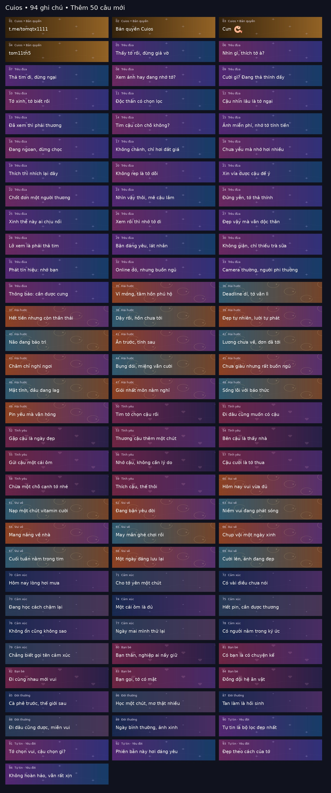

# Cuios v4.0.2 · 94 ghi chú, 90 nền riêng

## Bản JS làm rối Protected P1

[Module Protected P1](https://raw.githubusercontent.com/Cuongqtx11/locket_cuios_stable/main/locket_cuios_protected.sgmodule) có cùng engine, giới hạn video và ghi chú của bản này, dùng artifact làm rối riêng. Chỉ bật một module Locket; thử Protected trên máy trước khi quyết định dùng lâu dài.

Đã chạy lại toàn bộ kiểm thử trên bản Protected trong sandbox. Chưa kiểm chứng trên iPhone. **Đây không phải mã hóa chống sao chép tuyệt đối; repo vẫn public và còn file nguồn dễ đọc/lịch sử.** Ghi chú AI/câu tự nhận không tạo khóa xác thực. Xem [PROTECTED.md](PROTECTED.md) và [AI_NOTICE.md](AI_NOTICE.md).

**Repo:** [Cuongqtx11/locket_cuios_stable](https://github.com/Cuongqtx11/locket_cuios_stable).

Giữ xử lý Gold, mic/âm thanh, camera, upload, cache và khung Aura của bản `696fe10` mà người dùng xác nhận hoạt động. Bản này thay phần chọn nền của 90 ghi chú thường. Bốn ghi chú bản quyền giữ nguyên cả nội dung, icon, màu nền và URL ảnh từ v4.0.1.

## Video: đã có cấu hình 60s/100 MiB

| Chức năng | Cấu hình trong module | Quan sát từ người dùng |
| --- | --- | --- |
| Quay video | 60 giây | Đã quay được 60 giây |
| Nhập/upload video | 60 giây, 100 MiB = 104.857.600 bytes | App vẫn giới hạn khoảng 10 giây/6 MB |

Các giá trị upload đã được đặt từ trước bản này, gồm camera_roll, cấu hình upload và các giới hạn lồng nhau. **Không thay logic video trong v4.0.2**, không chèn thêm cờ phỏng đoán. Kiểm thử hồi quy vẫn mô phỏng đầu vào 10s/6 MiB và xác nhận response cấu hình được đổi thành 60s/100 MiB.

Giá trị cấu hình không chứng minh app hoặc máy chủ chấp nhận file dài/lớn. Nếu thực tế vẫn 10s/6 MB thì cần phân biệt app chưa activate, schema app không dùng các field này, hay giới hạn phía server; chưa đủ bằng chứng khẳng định máy chủ là nguyên nhân. Bản này không tuyên bố đã vượt được giới hạn upload thực tế.

## 90 nền mới cho 90 ghi chú thường

Mỗi ghi chú thường có **một PNG riêng**, không còn dùng chung hai ảnh theo nhóm. Tổng 90 ảnh, **768 × 256 px**, khoảng **3,37 MiB** cho toàn bộ bộ nền. Mỗi nhóm có nhiều phong cách và bảng màu khác nhau.

12 phong cách: cực quang, hologram ánh kim, neon, galaxy, lăng kính, vân lỏng, lụa ánh sáng, đốm lửa, sóng biển, hoa phát sáng, hoàng hôn và lưới cyber. Có glow, hạt sao, vân sáng, tia màu, khối kính và vùng tối mềm để giữ chữ trắng dễ đọc.

Màu và họa tiết được trộn ngẫu nhiên khi dựng bản phát hành; mỗi ghi chú giữ nền đã chọn trong cùng phiên bản để tránh nhảy nền hoặc thay ETag liên tục. Nền là **PNG có hiệu ứng thị giác tĩnh**, không thêm chuyển động native vào app.

Bốn mẫu đầu giữ nguyên:

1. **t.me/tomqtx1111**
2. **Bản quyền Cuios**
3. **Cưn🍤**
4. **tom11th5**

Vẫn có đủ **94 ghi chú**, giữ nguyên câu chữ, emoji và ID của bản 4.0.1. Không khôi phục nhóm Dịu dàng và không sửa ghi chú đã đăng.



## Cài module mới

```text
https://raw.githubusercontent.com/Cuongqtx11/locket_cuios_stable/main/locket_cuios_stable.sgmodule
```

Chỉ bật một module Locket trong cấu hình Shadowrocket đang dùng. Giữ HTTPS Decryption/MITM và CA đã tin cậy; kết nối Shadowrocket trước khi mở Locket. Module chính vẫn dùng `aura-frame`; bản `locket_cuios_no_widget.sgmodule` giữ khung server. Cả hai cùng có bộ nền mới.

Mọi rule dùng cùng runtime có hash trong tên. Link ghim commit cũ tiếp tục giữ phiên bản cũ, nên cần nhập link bản mới để nhận nền mới. App còn phải fetch/activate cấu hình; chỉ đổi URL module không xác nhận việc đó đã xảy ra.

## Hai repo được giữ

- [locket_cuios_stable](https://github.com/Cuongqtx11/locket_cuios_stable): bản này, cấu hình 60s/100 MiB và 94 ghi chú.
- [locket_cuios_10s_6mb](https://github.com/Cuongqtx11/locket_cuios_10s_6mb): bản 4.1.0 riêng, quay 60s và nhập 10s/6 MiB; không chỉnh sửa trong lần cập nhật này.

Runtime đã phát hành và các nền/khung cũ được giữ nguyên để các link ghim commit trước tiếp tục hoạt động.

## Kiểm tra và dựng lại

```bash
python3 tools/build_script.py
python3 tools/build_modules.py
npm run check
npm test
```

**43 test offline**: hồi quy video 60s/100 MiB, mic flags, RevenueCat/Firebase/cache; 94 ghi chú; đủ 90 ảnh riêng với SHA-256 khớp, 12 phong cách và đa dạng trong mỗi nhóm; so sánh bốn mẫu bản quyền giống hệt v4.0.1, gồm hash ảnh brand; kiểm tra engine ngoài phần styling/nhãn phiên bản giống engine được giữ lại.

Đã xem ảnh dựng thực tế để kiểm tra phối màu và chữ. Kiểm thử mã/ảnh không thay thế kiểm tra renderer hoặc upload trên iPhone.

Dựng bộ nền và ảnh xem trước bằng Pillow/NumPy ở bước authoring:

```bash
python3 -m pip install -r tools/requirements-artwork.txt
python3 tools/build_caption_backgrounds.py
python3 tools/build_script.py
python3 tools/build_modules.py
python3 tools/build_artwork.py --preview-only
npm test
```

`content/caption_backgrounds.json` ghi style, ảnh, màu dự phòng, SHA-256 và dung lượng. Ảnh mới có thư mục phiên bản và tên chứa hash, không sửa đè ảnh cũ. Đổi thiết kế đã phát hành cần tăng phiên bản. Runtime không dùng NumPy/Pillow, không chạy ngẫu nhiên hoặc gọi API tạo ảnh trên điện thoại. Mã kế thừa theo MIT.

## Mã nguồn và quyền truy cập

Xem [SECURITY.md](SECURITY.md) để biết kết quả quét, giới hạn của link raw, điều kiện chuyển private và việc JS trên thiết bị vẫn có thể bị sao chép. Hai repo hiện vẫn public để giữ module tải được; chưa có hosting thay thế.
