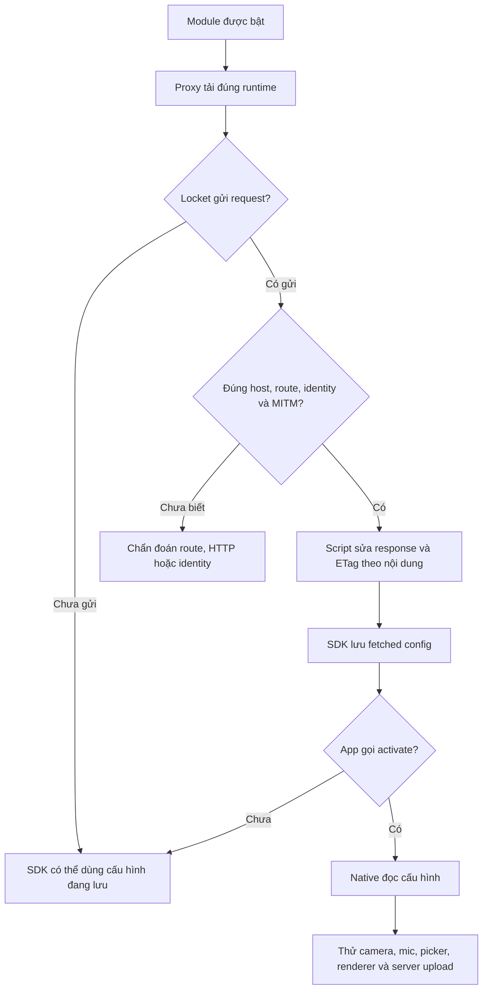

# Phân tích v4: cấu hình cũ còn hiệu lực và các chức năng không đồng bộ

## Hiện tượng từ người dùng

Khi luân phiên module, thời lượng lần lượt là 5/15/60 giây, rồi vẫn 60 giây khi chuyển lại bản thấp hơn. Mic/video thư viện từng có lúc hoạt động nhưng hiện không hoạt động. Chưa có log request hoặc báo cáo từ iPhone để đối chiếu đúng thời điểm.

Điều này phù hợp với việc kết quả phụ thuộc trạng thái đã lưu/lifecycle, không chỉ module vừa chọn. Nó không chứng minh một nguyên nhân cụ thể. Các repo cũ đã được đối chiếu commit/checksum và không bị thay đổi do nhân bản.

## Bằng chứng kỹ thuật

| Nguồn đã đọc | Cơ chế quan sát được | Giới hạn suy luận |
| --- | --- | --- |
| Firebase RCNConfigFetch.m | Có thể trả cache nội bộ trước khi tạo request; dùng ETag khi fetch | Không biết phiên bản SDK cụ thể trong Locket |
| FIRRemoteConfig.m | fetched và active là hai bước; activate kiểm tra lastETagUpdateTime so với lastApplyTime | Không chứng minh Locket đã gọi activate trong tình huống người dùng |
| RCNConfigSettings.m | Gán lastETag cập nhật thời điểm revision | Xoá ETag không tương đương xoá cache SDK; setter nil trong SDK hiện tại cũng có side effect, nên không kết luận mọi bản cũ đều lỗi do thiếu ETag |
| RevenueCat HTTPClient.swift | Header X-Client-Bundle-ID; cache SDK riêng; chữ ký response có thể được kiểm tra | Một User-Agent không nhận diện được không có nghĩa request không phải Locket |
| RevenueCat HTTPRequestPath.swift | Có host api-production.8-lives-cat.io cho fallback | Chưa biết thiết bị đang dùng host nào |

Nguồn Firebase tại commit `a05ee164071afc7508e5b3797fb6e88c4fab3aaf`:

- [RCNConfigFetch.m](https://github.com/firebase/firebase-ios-sdk/blob/a05ee164071afc7508e5b3797fb6e88c4fab3aaf/FirebaseRemoteConfig/Sources/RCNConfigFetch.m)
- [FIRRemoteConfig.m](https://github.com/firebase/firebase-ios-sdk/blob/a05ee164071afc7508e5b3797fb6e88c4fab3aaf/FirebaseRemoteConfig/Sources/FIRRemoteConfig.m)
- [RCNConfigSettings.m](https://github.com/firebase/firebase-ios-sdk/blob/a05ee164071afc7508e5b3797fb6e88c4fab3aaf/FirebaseRemoteConfig/Sources/RCNConfigSettings.m)
- [Hướng dẫn fetch/activate và interval](https://firebase.google.com/docs/remote-config/ios/get-started)

Nguồn RevenueCat tại commit `937b71ef0825f56d407569f06305b924eaea707c`:

- [HTTPClient.swift](https://github.com/RevenueCat/purchases-ios/blob/937b71ef0825f56d407569f06305b924eaea707c/Sources/Networking/HTTPClient/HTTPClient.swift)
- [HTTPRequestPath.swift](https://github.com/RevenueCat/purchases-ios/blob/937b71ef0825f56d407569f06305b924eaea707c/Sources/Networking/HTTPClient/HTTPRequestPath.swift)
- [Cấu hình host backup](https://www.revenuecat.com/docs/getting-started/configuring-sdk)

Bundle chính com.locket.Locket được đối chiếu qua [metadata App Store](https://itunes.apple.com/lookup?id=1600525061&country=vn). Project number 869942740286 là alias được đối chiếu cùng projectId locket-4252a trong tài liệu cấu hình Firebase đã đối chiếu; đây không phải bằng chứng Locket iOS dùng đường dẫn số. SDK Firebase iOS hiện tại dùng projectID khi xây URL.

## Chuỗi trạng thái cần phân biệt

Hook request không thể làm app phát sinh một request mà app chưa gửi. HTTP no-store không thay minimumFetchInterval hoặc cache RevenueCat/Remote Config nội bộ. Một trang chẩn đoán trả HTTP 200 chỉ xác nhận runtime/hook cục bộ hoạt động. Hai endpoint HTTPS kiểm tra có đường dẫn /cuios-check được trả lời local bởi script, ghi riêng với request Locket. Nếu hook không chạy, truy cập đường dẫn đó có thể tới API công khai và trả 404; 404 không được coi là thành công. HTTPS từ Safari không xác minh được TLS/pinning của riêng ứng dụng Locket.

## Các sửa đổi v4 có thể kiểm chứng offline

1. Đọc bundle headers trước UA; bundle khác app được giữ nguyên kể cả UA có chữ Locket.
2. Ba host RevenueCat được khai báo đồng bộ ở script/module/MITM. Chỉ sửa endpoint receipts/subscriber v1; route khác chỉ chẩn đoán.
3. Trả validator mới khi nội dung Firebase thay đổi, gồm cả personalization/rollout metadata. Cùng nội dung giữ validator ổn định. Đây là validator HTTP không dùng cho an toàn mật mã, không phải chữ ký hợp lệ RevenueCat.
4. Dữ liệu hợp lệ đã patch mang state UPDATE. NO_CHANGE không có entries giữ nguyên và được báo no_entries; không dựng cấu hình thiếu dữ liệu hoặc lấy payload của tài khoản/lần chạy khác để replay.
5. Toàn bộ profile cùng runtime, artifact URL gắn hash và manifest SHA-256. Không có script import/load một file chức năng riêng chưa được tải.
6. Diagnostics chỉ lưu phân loại schema, flag on/off, tên field media đã lọc, giới hạn số đã biết, mã HTTP, thời điểm và revision. Không lưu URL đầy đủ, token, header, UID hoặc raw response.
7. Key lưu riêng từng service tránh RC/Firebase ghi đè nhau khi chạy song song. Storage hỏng không chặn lưu lượng app; trang trạng thái có probe riêng để tránh nhầm thiếu storage với thiếu request.

## Điều chưa thể xác nhận bằng test offline

- Profile đang dùng thực sự cho phép Shadowrocket MITM và chạy script trên iPhone.
- Locket gọi fetch/activate khi mở lại hoặc khi bật proxy.
- Client hiện tại đọc các cờ mic, thư viện, video có tiếng hoặc format ghi chú đó.
- Video từ Photos có audio track và native encoder giữ track sau khi xử lý.
- Máy chủ nhận clip 60 giây/100 MiB và widget đọc event/asset mới.

Không có quyền truy cập iPhone hoặc source native Locket ở môi trường này. Để hoàn tất kiểm chứng cần báo cáo cục bộ sau khi mở Locket và kết quả test từng tính năng trên thiết bị. Nếu Firebase đã patch mà native vẫn không có mic/picker, cần xác định schema/khả năng native; không thể hứa sửa bằng thêm cờ không có bằng chứng.

40 test bao gồm tái hiện mô hình stale body/same ETag và validator mới, nhưng mô hình đó chỉ xác nhận lớp giao thức đã sửa, không chứng minh nguyên nhân thực trên thiết bị hoặc chức năng native đã thành công.
